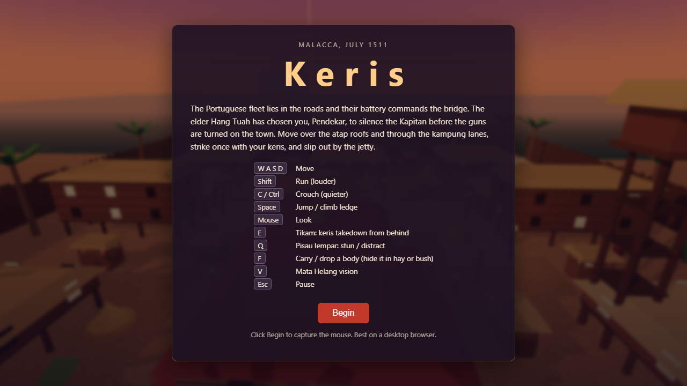
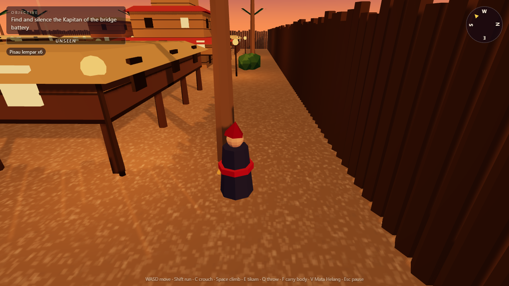
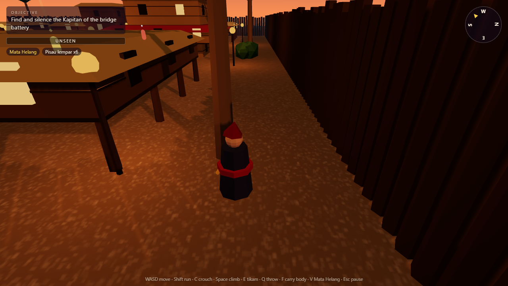

# Keris

A stealth-parkour browser game set in Malacca, 1511. You are a Pendekar sent to silence the Portuguese Kapitan of the bridge battery, then slip out by the jetty. Procedural geometry only, built with three.js.

**Live:** https://keris.taufikhamid.com (desktop only, keyboard and mouse)





## Controls

| Key | Action |
| --- | --- |
| W A S D | Move |
| Shift | Run (louder) |
| C or Ctrl | Crouch (quieter). Ctrl+W closes the tab in most browsers, so C is the safe choice |
| Space | Jump, or climb a ledge in front of you |
| Mouse | Look (pointer lock) |
| E | Tikam: keris takedown from behind, or on a stunned guard |
| Q | Pisau lempar: throw a knife to stun a guard, or make noise to distract |
| F | Carry the nearest body, or drop it. Drop it inside a haystack or bush to hide it |
| V | Mata Helang: shows guards, their vision cones and the target through walls |
| Esc | Pause |

Hide in haystacks and bushes to disappear from view. A takedown made while you are hidden in cover leaves the body hidden too. If an alert guard keeps you in reach for 2 seconds, you are caught and can restart.

## Stack

Next.js 16 (App Router), React 19, TypeScript, plain three.js in a client component, Vitest, ESLint, GitHub Actions CI. No backend.

## How it works

Game rules are pure functions in `src/game/logic.ts`, separate from rendering, so they are unit tested.

- **Vision:** a guard sees the player only if the player is within range, inside the cone half-angle, and an analytic ray-vs-box test finds no tall occluder in between. A hidden player is only seen at very close range.
- **Detection meter:** a 0..1 value per guard. It fills faster when the player is closer, running, and decays when unseen. Crouching slows it.
- **Guard state machine:** `patrol -> suspicious -> alert -> search -> patrol`. A meter above 0.25 or a heard noise makes a guard suspicious, a full meter makes it alert (and alerts nearby guards), losing sight for 3 s starts a search, and searching ends after 8 s.
- **Noise:** crouching, walking and running have different noise radii. Thrown knives that miss make noise where they land.
- **Takedown:** needs you within 2 m, behind the guard (or the guard stunned), and the guard not alert.
- **Body discovery:** a guard whose cone sees a downed guard fills a body-awareness meter (faster when close). Past 0.3 it goes to investigate; at full it raises the alarm at the body. A body inside cover is only seen at about 1.8 m, so hide them. Hay on a patrol lane is still risky.
- **Climbing guards:** alert and search guards remember the height of where they last saw you. If that is a rooftop, they walk to the nearest climbable edge (using a lower roof as a stepping stone when needed) and climb up, slower than you. Guards have gravity, so they drop back down if they walk off a roof.
- **Stilt houses:** the body of a house is raised above head height with thin post colliders, so you and guards can walk and hide under the floors while walls and roofs stay solid.
- **Lighting:** dusk hemisphere and ambient fill, 17 lantern point lights along the lanes, and light fog. Mata Helang lowers the fill and tints the fog blue for contrast.
- **Level:** `src/game/level.ts` builds stilt houses, atap roofs, kampung lanes, a three-tier palace, a harbour and a jetty from boxes and cones. Collision is circle-vs-box push-out; ledge climbing lerps onto a box top.

Tests cover the vision cone, line of sight, detection meter, noise, behind check, the guard state machine, stilt colliders, climb planning and body discovery (`npm test`).

## How I use AI

This was built with Claude Code, which wrote the code, tests and this README from my spec. What was checked: lint, typecheck, unit tests and the production build all pass, and a headless Playwright run loaded the page, started the game, walked the player, toggled Mata Helang and captured the screenshots above with no console errors. I have not playtested it thoroughly by hand, so expect balance and feel issues.

## Rough edges

- Guard climbing and body carrying are new and only lightly playtested. Guards climb in a straight lerp, not along real ladders, and pathing is not navmesh based (they can snag on walls).
- Art is low-poly primitives, no audio, desktop only.

## Local dev

```bash
npm install
npm run dev        # http://localhost:3000
npm run lint && npm run typecheck && npm test && npm run build
```

## Credit

Inspired by the stealth genre. Not affiliated with Ubisoft. Setting and story draw on my earlier Malacca 1511 prototype.
